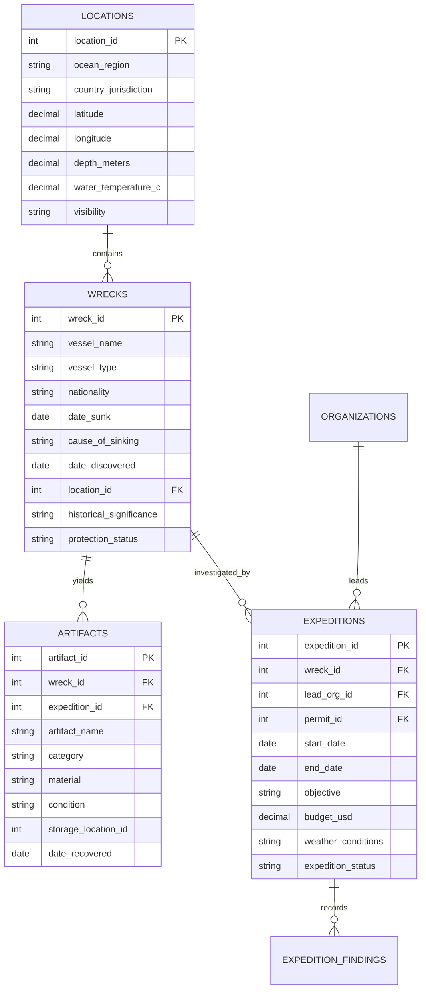

# Product Requirements Document (PRD)
## Shipwreck Archive Management System (PERN Stack)

---

### 1. Document Overview
* **Project Name**: Shipwreck Archive Management System
* **Stack**: PERN (PostgreSQL, Express.js, React, Node.js)
* **Target Database**: `Ship Wreck Archieve` (Local PostgreSQL / pgAdmin 4)
* **Document Status**: Draft / Ready for Implementation

---

### 2. Product Summary & Objectives
The **Shipwreck Archive Management System** is a responsive web application designed for marine archaeologists, maritime historians, and research organizations to catalog, monitor, and analyze shipwreck data. 

The application provides:
1. **Full CRUD functionality** across core maritime entities (`wrecks`, `artifacts`, `expeditions`, `locations`).
2. **Interactive Metrics & Analytics Dashboard** displaying key insights (vessel distribution by era/nationality, depth metrics, expedition expenditures, artifact preservation status).
3. **Navigable, User-Friendly Interface** featuring intuitive navigation, filtering, search, pagination, and modal-based data entry.

---

### 3. Database Schema Reference

Based on your local PostgreSQL database (`Ship Wreck Archieve`), the key entity models are:



---

### 4. Key Features & Functional Requirements

#### 4.1. Navigable Interface & Layout
* **Global Navigation Bar / Sidebar**:
  * **Dashboard / Analytics**: Summary cards, charts, and key performance metrics.
  * **Wrecks Directory**: Table view, filters (nationality, status, depth), and details modal/page.
  * **Artifacts Catalog**: Material & condition breakdown, recovery timeline, search bar.
  * **Expeditions Log**: Status tracker (planned, ongoing, completed), budget indicators.
  * **Locations Map / List**: Coordinates, depth ratings, and visibility metrics.
* **Notification Toast System**: Feedback for successful insertions, updates, and deletions.

#### 4.2. Metric Dashboard (KPIs & Visualizations)
* **Summary Metrics**:
  * Total Documented Wrecks
  * Total Recovered Artifacts
  * Active/Ongoing Expeditions
  * Total Research Capital Invested (Budget Sum)
* **Visual Analytics**:
  * **Wrecks by Nationality & Vessel Type** (Bar / Pie chart)
  * **Artifact Condition Breakdown** (`good`, `fair`, `excellent`, `fragmentary`, `poor`)
  * **Expedition Budget vs. Findings** (Scatter or Bar chart)
  * **Depth Distribution** (Histogram of wreck depths in meters)

#### 4.3. CRUD Specifications
* **Create (C)**:
  * Modal form with client-side validation (vessel name required, dates formatted, valid foreign key dropdowns).
* **Read (R)**:
  * Sortable, searchable data tables with pagination.
  * Quick search by vessel name, nationality, or artifact category.
* **Update (U)**:
  * Inline editing or edit modal pre-filled with existing record attributes.
* **Delete (D)**:
  * Safe delete with confirmation dialog (e.g. "Are you sure you want to delete HMS Sentinel?").

---

### 5. System Architecture & API Endpoints

#### 5.1. Tech Stack
* **Database**: PostgreSQL (`Ship Wreck Archieve`) accessed via `pg` (node-postgres) connection pool.
* **Backend**: Node.js + Express.js REST API with CORS and dotenv configuration.
* **Frontend**: React (Vite) + Tailwind CSS / Lucide Icons + Recharts / Chart.js for data visualization.

#### 5.2. RESTful API Routes
| Method | Endpoint | Description |
| :--- | :--- | :--- |
| `GET` | `/api/metrics/summary` | Aggregate counts and statistics for the dashboard |
| `GET` | `/api/metrics/analytics` | Grouped datasets for charts (types, conditions, budgets) |
| `GET` | `/api/wrecks` | List all wrecks (supports `?search=`, `?status=`, `?page=`) |
| `GET` | `/api/wrecks/:id` | Get single wreck with nested artifacts and expeditions |
| `POST` | `/api/wrecks` | Create a new wreck record |
| `PUT` | `/api/wrecks/:id` | Update an existing wreck record |
| `DELETE` | `/api/wrecks/:id` | Delete a wreck record |
| `GET` | `/api/artifacts` | List artifacts with search & material filter |
| `POST` | `/api/artifacts` | Add new recovered artifact |
| `GET` | `/api/expeditions` | List all expeditions and statuses |
| `GET` | `/api/locations` | List available geographic coordinates and depths |

---

### 6. Step-by-Step Implementation Guide

Follow these steps to configure and run the application locally:

#### Step 1: Backend Setup
1. Create a `server/` directory and initialize:
   ```bash
   mkdir server && cd server
   npm init -y
   npm install express pg cors dotenv
   npm install --save-dev nodemon
   ```
2. Configure `.env` with your pgAdmin credentials:
   ```env
   PORT=5000
   DB_USER=postgres
   DB_PASSWORD=your_pgadmin_password
   DB_HOST=localhost
   DB_PORT=5432
   DB_NAME=Ship Wreck Archieve
   ```
3. Set up the connection pool (`server/db.js`):
   ```javascript
   const { Pool } = require('pg');
   require('dotenv').config();

   const pool = new Pool({
     user: process.env.DB_USER,
     host: process.env.DB_HOST,
     database: process.env.DB_NAME,
     password: process.env.DB_PASSWORD,
     port: process.env.DB_PORT,
   });

   module.exports = pool;
   ```
4. Define standard CRUD controller routes for `/api/wrecks`, `/api/artifacts`, and `/api/metrics`.

#### Step 2: Frontend Setup
1. Scaffold a React app with Vite:
   ```bash
   cd ..
   npm create vite@latest client -- --template react
   cd client
   npm install axios lucide-react recharts
   npm install -D tailwindcss postcss autoprefixer
   npx tailwindcss init -p
   ```
2. Build the visual hierarchy:
   * **`Sidebar.jsx`**: Links to Dashboard, Wrecks, Artifacts, Expeditions.
   * **`DashboardView.jsx`**: Metric stat cards + Recharts graphs.
   * **`WrecksTable.jsx`**: Data table with Add/Edit/Delete actions.
   * **`WreckModal.jsx`**: Form for Create / Edit operations.

#### Step 3: Run & Verify
1. Start backend: `cd server && npm run dev`
2. Start frontend: `cd client && npm run dev`
3. Access `http://localhost:5173` to interact with your shipwreck database.

---

### 7. Non-Functional Requirements & Security
* **SQL Injection Prevention**: Use parameterized queries (`$1, $2`) for all database operations.
* **Error Handling**: Standardized JSON responses (`{ success: false, message: "..." }`).
* **Connection Resilience**: Graceful error catching on connection drops with auto-reconnect pool.
* **Responsive Layout**: Fluid breakpoints for desktop, tablet, and mobile views.
